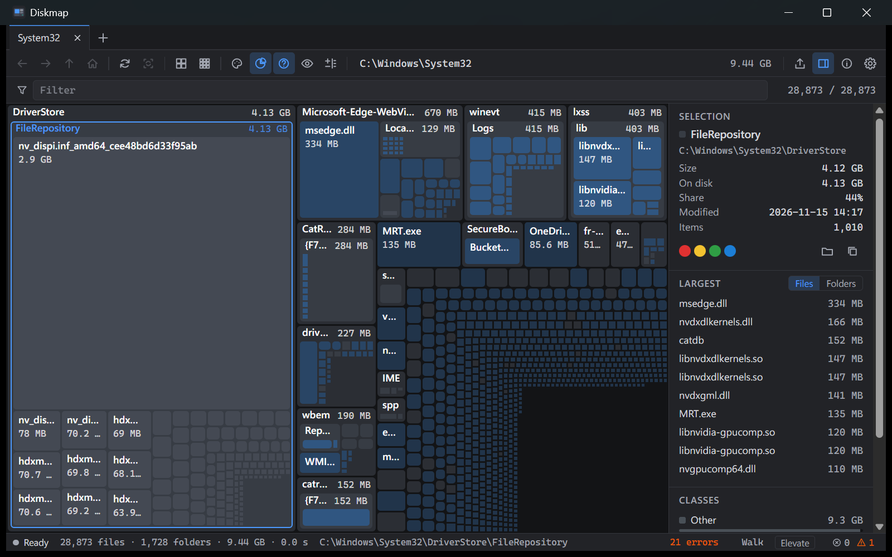
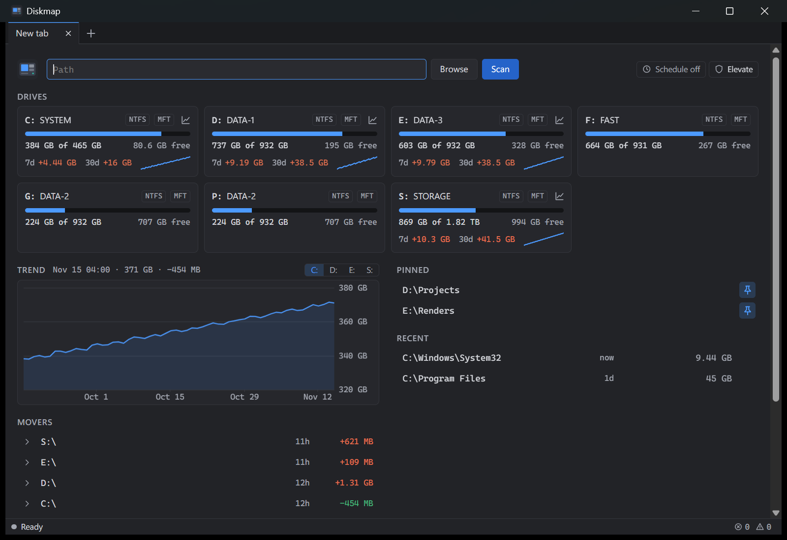
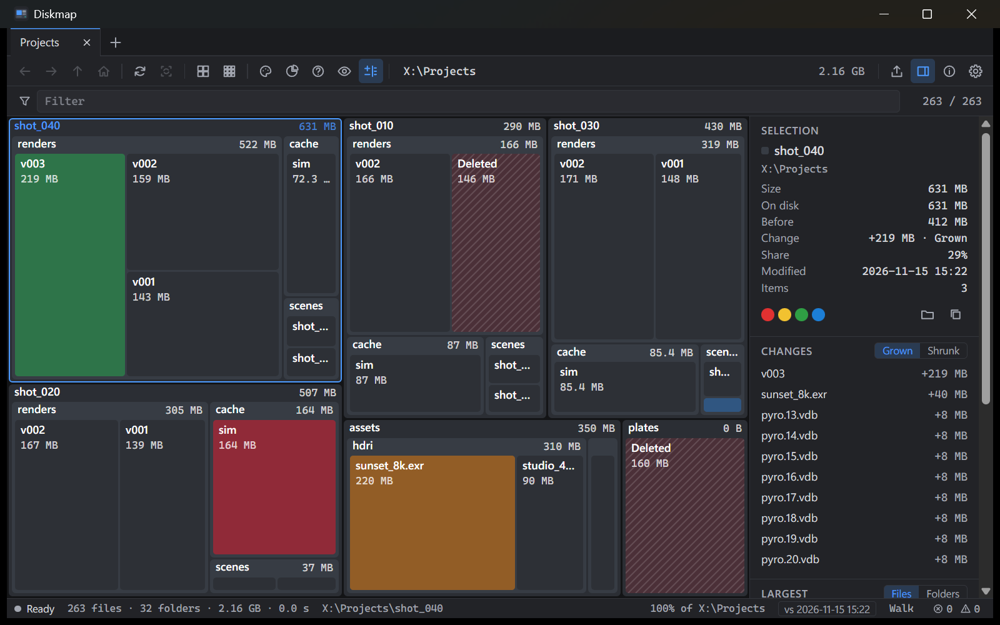

# diskmap

Windows disk-usage treemap.



Navigation inspired by SpaceSniffer.

## Features

- Squarified treemap of a folder or drive, drawn on a canvas with nested folders.
- Parallel directory walk, or a raw NTFS MFT scan when run as administrator.
- Live updates from a file-system watcher, with an optional highlight of recent changes.
- Snapshots and compare mode: tiles coloured by change (new, grown, shrunk), deleted bytes as hatched tiles, a Changes list.
- Dashboard start screen: drive usage with 7 and 30 day change, a trend chart per drive, the changes per drive over 7 days, 30 days or all the history.
- Periodic scans from Windows Task Scheduler, with a timeline per root and a toast with the top movers.
- Filter language: name masks, size, age, attributes, folders, file classes, colour tags and change status.
- File colours by accent, file class or age.
- Colour tags (4), file classes with editable colours and extensions.
- Pinned folders, tabs, back and forward over zooms, breadcrumb, free and unknown space of the volume.
- Side panel with the selection, changes, the largest files and folders and bytes per class.
- CSV and JSON export of the view, the selection and the top files and folders.
- Output panel with the application log.
- Installer or portable exe, auto updates, winget package.
- Five themes, UI scale, detail level 1 to 12.
- `diskmap-bench` command line tool to time and compare the scan backends.

| Dashboard | Compare mode |
| --- | --- |
|  |  |

## Install

Requires Windows 10 or 11 and the WebView2 runtime (part of Windows 11 and current Windows 10). Each [release](https://github.com/paul-charp/Disk-Map/releases) has two downloads; the installer is also on winget once the package is accepted (`winget install PaulCharp.Diskmap`):

| Asset | Kind | Settings | Data (snapshots, timeline, log) |
| --- | --- | --- | --- |
| `diskmap-vX.Y.Z-windows-x64-setup.exe` | Installer, per user, no admin | `%APPDATA%\diskmap\diskmap.toml` | `%LOCALAPPDATA%\diskmap\data\` |
| `diskmap-vX.Y.Z-windows-x64-portable.exe` | Portable | `diskmap.toml` next to the exe | `data\` next to the exe |

- Installer: installs to `%LOCALAPPDATA%\diskmap` by default (data in its `data` subfolder), adds a Start menu shortcut and, from a checkbox on the last page, a desktop shortcut. It downloads WebView2 only if it is missing. Uninstall from Windows Settings, Apps; settings and data are kept unless "Delete the application data" is ticked.
- Portable: put the exe in any folder and run it; settings and data stay in that folder. Any copy of the exe the installer did not put in place runs portable.
- `DISKMAP_CONFIG` overrides the settings path in both modes.
- Updates: installed builds check at startup (Settings, About, Auto check) and show an `Update x.y.z` chip in the status bar; Install downloads the signed installer, runs it in passive mode and restarts. Portable builds only check and link to the release page. See [docs/distribution.md](docs/distribution.md).

The exes are not code-signed, so SmartScreen may warn on first run (More info, Run anyway). `diskmap-bench` is a development tool built from source, not part of the release.

## Usage

- Start screen: type a path (several separated by `;`), pick a drive, a pinned folder or a recent scan, or browse. Folders dropped on the window open in tabs. Paths on the command line open one tab each.
- Dashboard: drive cards with used space, 7 and 30 day change and a sparkline; the Trend chart of used space per drive; Changes per root over 7d, 30d or All with the top movers, which open a tab or Compare against the latest snapshot. Home is a fixed first tab. About and Settings at the top right.
- Click a folder or file to select it; the map digs in place to show its contents.
- Double click to zoom to the folder (the parent for a file). Back and Forward step through zooms only; Up and Root zoom out.
- Right click: Open, Open in terminal, Reveal, Copy path, Properties, Scan in new tab, Pin, Recycle, tags, Export CSV and Zoom.
- Toolbar: rescan, rescan view, detail, file colours (Accent, Class, Age), free and unknown space, Watch, Compare, Export, side panel, About and Settings.
- Tabs: one scan per tab, Ctrl+N for a new tab, middle click to close, drag to reorder.
- Filter bar: Presets (built-in and saved filters, Save, Clear) and Syntax (tokens by group, click to insert).
- Live updates: the Watch toggle (Ctrl+L) follows changes after a scan. Highlight changes is in Settings, Scan.
- Snapshots: a full snapshot is saved after every full scan (Settings, Scan: Auto snapshot, Keep snapshots), or with Compare, Save now. Compare lists the snapshots of the root; Settings, Snapshots manages them all (Keep, Compare, Reveal, Delete).
- Periodic scans: Settings, Schedule registers a daily or weekly task `diskmap\Snapshot` that runs `diskmap.exe --snapshot <root>... --quiet`, optionally elevated for the MFT backend. Each run adds a timeline point and a report. See [docs/snapshots.md](docs/snapshots.md).
- MFT scan: start `diskmap.exe` as administrator, or use Elevate in the status bar or on the start screen, which relaunches with the open tabs. The backend (Settings, Scan) is Auto, MFT or Walk; the status bar shows which one ran.
- Output (Ctrl+`): the application log with a level filter, Copy and Clear; the status bar shows error and warning counts. Also written to `diskmap.log` in the data folder.

## Keyboard shortcuts

| Key | Action |
| --- | --- |
| Ctrl+N | New tab |
| Ctrl+W | Close tab |
| Ctrl+Tab / Ctrl+Shift+Tab | Next / previous tab |
| Ctrl+Shift+PageUp / PageDown | Move tab |
| Ctrl+, | Settings |
| F5 | Rescan / stop |
| Backspace | Back |
| Shift+Backspace | Forward |
| Ctrl+Up | Up |
| Ctrl+Home | Root |
| Ctrl++ / Ctrl+- | Detail |
| Ctrl+T | File colours |
| Ctrl+F | Free space |
| Ctrl+U | Unknown space |
| Ctrl+L | Watch |
| Ctrl+B | Side panel |
| Ctrl+` | Output |
| Ctrl+1 to Ctrl+4 | Tag hovered or selected item |
| Ctrl+0 | Clear tags |

Mouse buttons 4 and 5 act as Back and Forward.

## Filter syntax

Conditions are separated by `;`. A leading `|` negates a condition. The Presets and Syntax buttons at the end of the filter bar fill it in. See [docs/filters.md](docs/filters.md).

| Example | Matches |
| --- | --- |
| `*.jpg;*.png` | Files with either name mask |
| `\node_modules` | Files inside a folder with that name |
| `size>100mb` | Files larger than 100 MB |
| `modify<7d` | Files modified less than 7 days ago |
| `access>1year` | Files not accessed for more than a year |
| `:attr:hidden+system` | Hidden and system files |
| `:class:Video;size>1gb` | Videos larger than 1 GB |
| `:tag:red,blue` | Files tagged red or blue |
| `\src;*.rs;\|\target` | Rust files inside `src`, outside `target` |
| `is:new;is:grown` | In compare mode: new or grown files |
| `delta:>1GB` | In compare mode: files that grew by more than 1 GB |

## Build

Requires Rust 1.90 or newer.

```powershell
cargo build --release -p diskmap
```

The executable is `target\release\diskmap.exe`. The installer needs the Tauri CLI (it fetches NSIS itself):

```powershell
cargo install tauri-cli --version "^2" --locked
cd crates\desktop
cargo tauri build --bundles nsis --no-sign
```

`--no-sign` skips the updater signature; without it the build needs `TAURI_SIGNING_PRIVATE_KEY` (see [docs/distribution.md](docs/distribution.md)).

The installer is written to `target\release\bundle\nsis\Diskmap_<version>_x64-setup.exe`.

## Test

```powershell
cargo test --workspace
cargo fmt --all -- --check
cargo clippy --workspace --all-targets -- -D warnings
```

The front end in `crates/desktop/ui` is plain HTML, CSS and ES modules; there is no Node build step. See [docs/architecture.md](docs/architecture.md), [docs/scanning.md](docs/scanning.md) and [docs/snapshots.md](docs/snapshots.md).

## Contributing

Work happens on `develop` and `feature/*` branches; `main` holds releases. See [docs/branching.md](docs/branching.md); release assets, updater keys and winget in [docs/distribution.md](docs/distribution.md). Planned work: [docs/roadmap.md](docs/roadmap.md).

## Licence

MIT, see [LICENSE](LICENSE).
